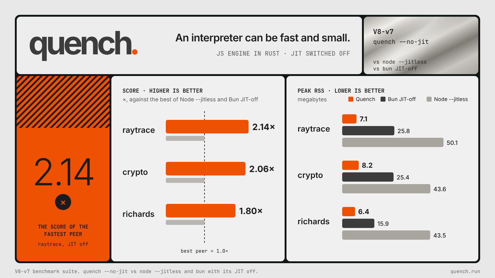

<p align="center">
  <a href="https://quench.run">
    
  </a>
</p>

<h3 align="center">A JavaScript, TypeScript and WebAssembly runtime, written in Rust.</h3>

<p align="center">
  One interpreter defines what JavaScript means. Two JIT tiers and an AOT compiler are that interpreter, specialized.
</p>

<p align="center">
  <a href="https://github.com/tc39/test262"></a>
  <a href="https://github.com/WebAssembly/spec"></a>
  
  <a href="LICENSE-MIT"></a>
  <a href="https://github.com/butaji/quench/stargazers"></a>
</p>

<p align="center">
  <a href="https://quench.run">Website</a> ·
  <a href="https://quench.run/blog/">Blog</a> ·
  <a href="#built-for-agent-code-mode">For AI agents</a> ·
  <a href="#quick-start">Quick start</a> ·
  <a href="#benchmarks">Benchmarks</a> ·
  <a href="#how-it-works">How it works</a>
</p>

---

```console
$ quench app.ts                      # run TypeScript, JavaScript or WebAssembly
$ quench --build-aot app.ts -o app   # or compile the whole program to one native executable
$ ./app
```

## Why Quench

- **Conformant first.** Test262 passes 53,353 tests with zero failures, with the JIT off and on. The WebAssembly spec suite passes 67,124 of 67,124.
- **Small.** With the JIT off, Quench peaks at a quarter to a half of the memory Node or Bun use on most V8-v7 benchmarks.
- **Fast without a JIT.** On V8-v7 the interpreter alone scores 1.49x to 2.57x the best of `node --jitless` and Bun with its JIT off.
- **One semantics.** The interpreter, b-jit, u-jit and AOT derive each opcode's meaning from one shared definition, so the tiers agree about what a program means. The few hand-written exceptions left are tracked in a list that may only shrink.
- **TypeScript types are kept.** Types are not erased before execution. They feed the specializer, so typed code can start out specialized.
- **Tiny native executables.** `quench compile --strict-aot` runs the program at build time up to its first run-time input and keeps only what is left. Hello world is a 4,896-byte executable that starts in 0.96 ms with 1.3 MB peak memory, level with C. Inputs it cannot fold are refused by name, never baked in. [How it works](https://quench.run/blog/hello-world-in-4896-bytes/).
- **Node-compatible.** `node:` APIs are implemented in Rust and checked against a local Node oracle, and the source is parsed by [OXC](https://github.com/oxc-project/oxc).

## Built for agent Code Mode

More and more agents write code and run it inside the harness instead of chaining tool calls one at a time. A busy machine can host hundreds of these agents, each running code nobody reviewed. That needs a JavaScript engine that lives inside the harness, stays small, runs without a JIT, and runs whatever the model wrote. That is the slot Quench is built for.

- **The QuickJS slot, with more speed.** Today the choice is QuickJS for small scripts or V8 for heavy ones. Quench aims at QuickJS's place (small, embedded, interpreter only) with an interpreter well ahead of the ones in V8 and JavaScriptCore: with the JIT off, V8-v7 scores 1.49x to 2.57x the best of `node --jitless` and Bun JIT-off, and five of the eight benchmarks peak at 6.4 to 8.2 MB, against 43 to 50 MB for Node and 16 to 26 MB for Bun. We have not benchmarked against QuickJS yet; that comparison is next, and it will be published either way.
- **Embeddable and Rust-native.** [`quench-runtime`](crates/quench-runtime) is a Rust library. The harness creates a `Runtime` with its own `Host`, exposes its tools as host functions, and can stop runaway code from another thread with an execution interrupt. Generated code runs in the harness's own process, with no subprocess and no IPC. It is not on crates.io yet and the API will still change.
- **No JIT required.** `--no-jit`, which is also the library's default mode, runs the interpreter only (WebAssembly included), so no machine code is generated while untrusted code runs. That takes JIT compiler bugs off the attack surface and gives an attacker far less control over the machine code that executes, which Spectre-style attacks rely on. The speed above is measured with the JIT off. The engine is still not a sandbox on its own: isolation and limits come from your host.
- **Full JavaScript and TypeScript.** Test262 passes 53,353 tests with zero failures, TypeScript runs directly with no build step, and `node:` APIs are there too. Code a model writes just runs: there is no "Lua needs a C extension for that" step, and models write JavaScript and TypeScript far better than Lua.

## Benchmarks

<p align="center">
  
</p>

V8-v7 suite, interpreter only in every engine: `quench --no-jit` against `node --jitless` and Bun with `BUN_JSC_useJIT=0`. Score is relative to the faster of the two (higher is better); memory is peak RSS relative to the smaller of the two (lower is better). Measured 14 November 2026 on a 4-core Linux machine.

| Benchmark     | Quench score | Node `--jitless` | Bun JIT off | Score vs best | Quench RSS | RSS vs best |
| ------------- | -----------: | ---------------: | ----------: | ------------: | ---------: | ----------: |
| navier-stokes |        7,166 |            1,723 |       2,788 |     **2.57x** |     7.6 MB |   **0.38x** |
| raytrace      |        8,084 |            3,780 |       2,711 |     **2.14x** |     7.1 MB |   **0.28x** |
| crypto        |        3,520 |            1,232 |       1,706 |     **2.06x** |     8.2 MB |   **0.32x** |
| splay         |        6,940 |            3,722 |       2,995 |     **1.86x** |    58.7 MB |       1.07x |
| richards      |        2,759 |            1,220 |       1,529 |     **1.80x** |     6.4 MB |   **0.40x** |
| regexp        |        5,179 |            3,049 |         709 |     **1.70x** |    16.2 MB |   **0.50x** |
| deltablue     |        2,237 |            1,488 |       1,200 |     **1.50x** |     6.9 MB |   **0.28x** |
| earley-boyer  |        8,365 |            5,600 |       4,686 |     **1.49x** |    15.8 MB |   **0.55x** |

Not every row is a win yet: splay uses slightly more memory than Bun. On the larger [JetStream 3](https://quench.run/blog/where-quench-stands/) suite with the JIT off, Quench's geometric-mean score is 34.3 against Node's 39.7 and Bun's 32.2, at 28.5 MB peak memory against 110.1 MB and 47.7 MB. Closing that score gap is the current work.

## Quick start

Quench is early and has no packaged releases yet. Build it from source with the pinned Rust toolchain (`rust-toolchain.toml`, installed by `rustup` automatically):

```sh
git clone https://github.com/butaji/quench
cd quench
cargo build --release -p quench                    # interpreter + JIT tiers
cargo build --release -p quench --features aot     # adds the AOT compiler
```

The engine itself is pure Rust; the Node layer links OpenSSL (for `node:crypto` and TLS) and zstd.

Then run something you already have:

```sh
./target/release/quench app.ts
./target/release/quench -e 'console.log([1, 2, 3].map(x => x * 2))'
```

Choose an execution tier with a flag. Every mode must print the same output:

| Flag        | What runs                                            |
| ----------- | ---------------------------------------------------- |
| *(default)* | Interpreter, tiering up to the native tiers when hot |
| `--no-jit`  | Interpreter only                                     |
| `--b-jit`   | Copy-and-patch baseline JIT                          |
| `--u-jit`   | Cranelift optimizing JIT                             |

## How it works

```
             TypeScript / JavaScript / Wasm
                          │  OXC parser, types kept
                          ▼
                  register bytecode
                          │
     ┌───────────────┬────┴──────────┬────────────────┐
     ▼               ▼               ▼                ▼
 interpreter       b-jit           u-jit             AOT
 one 64-bit     copy-and-patch    Cranelift      whole program →
 word / value     stencils       optimizing     native executable
     └───────────────┴──── one opcode definition ─────┘
```

Each opcode's meaning is written once, as a staged row over a `Stage` trait. The interpreter runs the row directly, b-jit instantiates it as prebuilt machine-code stencils, and u-jit and AOT emit it as Cranelift IR. These are [Futamura projections](https://en.wikipedia.org/wiki/Partial_evaluation#Futamura_projections) in practice: every native tier is the interpreter specialized to what is known about the program.

The engine follows a few laws, enforced by lints and tests in this repository ([AGENTS.md](AGENTS.md)):

- **Check once.** A fact about a value is proved at most once, then trusted by every later use and every later tier.
- **Reactive, not guarded.** Facts that rarely change, such as shapes, prototype chains and callee identity, are dependencies that invalidate code when they change, so the fast path pays nothing per use.
- **Measured against C.** Every operation has an instruction budget, with the C a programmer would write as the reference.

| Crate | What it is |
| ----- | ---------- |
| [`quench-runtime`](crates/quench-runtime) | Interpreter, object model, GC, u-jit and AOT |
| [`quench-bjit`](crates/quench-bjit) | Copy-and-patch stencils for b-jit |
| [`quench`](crates/quench) | The `quench` binary and Node-compatible APIs |
| [`quench-wasm`](crates/quench-wasm) | WebAssembly |
| [`quench-regexp`](crates/quench-regexp) · [`quench-intl`](crates/quench-intl) · [`quench-temporal`](crates/quench-temporal) | RegExp, Intl and Temporal |
| [`quench-test262`](crates/quench-test262) | Test262 runner with Node-arbitrated waivers |

## Conformance

The Test262 runner reports every raw outcome. 53 cases fail in exactly the way Node fails them (for example, Node has no `Error.prototype.stack` accessor); they are listed with reasons in [`node-waivers.json`](crates/quench-test262/node-waivers.json) and stay counted as failures in every report. A waiver is rejected the moment its case starts passing or fails differently.

## Roadmap

- [x] Test262 with zero unexplained failures, JIT off and on
- [x] WebAssembly spec suite, 100%
- [x] Interpreter ahead of `node --jitless` and Bun JIT-off on every V8-v7 row
- [ ] Interpreter at 1.5x the best peer's score and half its memory on every V8-v7 and JetStream 3 row
- [ ] Each native tier faster than the one below it, with u-jit within 5x of the equivalent C
- [ ] AOT executables within 5x of C on JetStream
- [ ] 100% Node API parity
- [ ] Packaged releases

## Contributing

The most useful thing you can send is a program that breaks or runs slowly: build Quench, point it at TypeScript or JavaScript you already have, and [open an issue](https://github.com/butaji/quench/issues). `quench-wasm`, `quench-regexp` and `quench-intl` are self-contained and good places to start on the engine. [AGENTS.md](AGENTS.md) lists the rules and gates every change passes.

---

<p align="center">
  <b>If an engine that is small, fast without a JIT and honest about its numbers is something you want to exist, please ⭐ star the repo.</b><br>
  It is how we know to keep going.
</p>

<p align="center">
  <a href="https://github.com/butaji/quench/stargazers"></a>
</p>

<p align="center"><sub>MIT licensed · <a href="https://quench.run">quench.run</a></sub></p>
